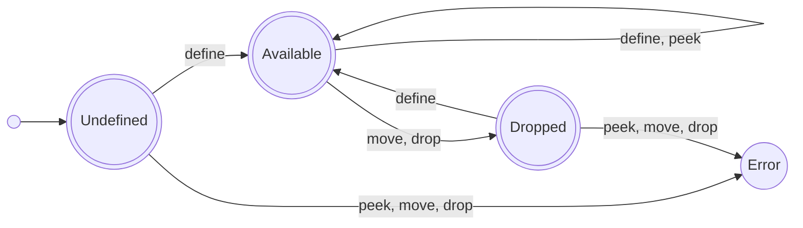

# Single Assignment and Ownership
by **Marco Nikander**

A concept for a memory-safe intermediate representation is presented.
It combines **static single-assignment form** and the **single-ownership principle** into one IR.
If a given program can be compiled into this IR, then the validity of all references can be analyzed statically via borrow checking.
This IR guarantees memory-safety without needing a garbage collector.
It is intended for domains which have these requirements.
Key design decisions and the resulting properties of the IR are discussed.
The IR emphasizes simplicity of the concepts and the analysis, at the expense of some expressiveness.
The pointer-graph is a directed acyclic graph, by construction.
Certain programming constructs, such as doubly-linked lists, cannot be expressed directly.
The present formulation supports only integers, references, expressions, and control flow.
Future work includes tuples, unions, arrays, function-pointers, and side-effects.

## A Few Ideas

[**Static single-assignment (SSA) form**](https://en.wikipedia.org/wiki/Static_single-assignment_form) is a form of code where each variable is assigned-to only once.
Languages which allow the mutation of values can be translated into SSA by _versioning_ variables.
A variable `x`, whose value is changed several times in the original program, is replaced by `x_0`, `x_1`, `x_2`, ... in SSA form.
SSA form makes dataflow clearly visible and is well-suited for many compiler optimizations.
Many production compilers use intermediate representations (such as LLVM IR) which are based on SSA form.

**Resource** is a general term used to refer to entities such as data in memory, file handles, network connections, or hardware devices such as a GPU.
Resources typically have a state.
Many resources require construction to acquire them, and destruction to dispose of them.
Some examples are:
- memory which must be allocated and freed
- a file handle which must be opened and closed
- a network socket which must be opened and closed

[**Resource acquisition is initialization (RAII)**](https://en.wikipedia.org/wiki/Resource_acquisition_is_initialization) is a programming technique where a constructor is used to acquire a resource and a destructor is used to release that resource.
This ties a resource to the lifetime of one or more objects.
Smart pointers are a typical example of this technique.

**Single ownership** is the notion that _exactly one_ variable is responsible for one resource.
This is closely related to RAII.
Only that one variable, the 'owner' is allowed to modify the state of that resource.
The owner has the cleanup obligation for the resource.
Ownership can be transferred from one variable to another, or from one function to another.
This is commonly called `move`.
Single ownership stands in contrast to shared ownership, where several variables are allowed to modify the state of a resource.

<!-- TODO: very briefly explain what I mean by memory safety -->

_Static Single Assignment (SSA)_ and _Single Ownership (SO)_ can be combined in an intermediate representation which satisfies both properties.
Typically, in SSA, there is a notion of a "def-use" chain.
This refers to the definition of a variable, and its subsequent uses in computations.
To model ownership, moving, dropping, and also references, a richer set of primitives is needed, than just SSA provides.

## A Language and a Machine

The workings of single assignment and ownership can be explained using a small integer-only language and a machine which runs it.
**When our fictional machine is running, it calls functions, computes values, creates and destroys variables, jumps from block to block, and returns from functions.**
How exactly these variables are stored, on the heap, in the stack frame, in registers, or inlined in the source code, is _not relevant_ for our abstract machine.
What _is_ relevant for our machine is ownership, references, and the availability of variables.

Our language is structured as follows:
- A program is a list of functions.
- A function is a list of blocks.
- A block is a list of instructions.
- The instructions within a block can `define` or `drop` variables.
- The _last_ instruction of every block is control-flow instruction (`goto`, `branch`, `return`).
- A `define` has a value-producing operation on the right hand side.
- An operation takes operands.
- An operand is either a `constant` value, a `peek` (read) of an existing variable, or a `move` of an existing variable.
- Operations include an identity function, function calls, referencing and dereferencing, as well as unary and binary operations.
- The naming convention for functions, blocks, and variables is similar to [Multi-Level Intermediate Representation (MLIR)](https://en.wikipedia.org/wiki/MLIR_(software)) in the LLVM project.
- Functions can take parameters.
- Blocks can take parameters. This is equivalent to Phi-nodes from classical SSA. [Block parameters](https://mlir.llvm.org/docs/LangRef/#blocks) are taken from MLIR.
- The language supports integers and references. Note that a type-checker must forbid the casting of references to integers and must forbid "pointer arithmetic" on references, so that these programs are memory-safe.
- The language does not support tuples, variants, structs, arrays, or other datatypes.
- The language does not support side-effects, such as file IO.

<!-- TODO: does this syntax need an end terminal such as ';' or 'end' to mark the end of a term? -->
The syntax is given by the following context-free grammar:
```abnf
; programs, functions, and blocks
program     = *function                       ; a program is a list of functions
function    = "function" functionId *parameter *block
block       = "block" blockId *parameter *(define / drop) terminator
parameter   = "parameter" *variableId
terminator  = goto / branch / return

; basic forms
define      = "define" variableId expression  ; create a variable
drop        = "drop" variableId               ; destroy a variable
goto        = "goto" target                   ; unconditional branch
branch      = "branch" operand target target  ; conditional branch
return      = "return" variableId             ; return from a function

; expressions
expression  = identity / call / reference / dereference / unary / binary
identity    = "identity" operand              ; copy/forward an operand
call        = "call" functionId *operand      ; function call
reference   = "reference" peek                ; create reference to a variable
dereference = "dereference" (peek / move)     ; access the underlying variable
unary       = "unary" operand                 ; placebo for: not, negate
binary      = "binary" operand operand        ; placebo for: add, subtract, ...

; jump targets, operands, identifiers
target      = "target" blockId *operand       ; branch-target with arguments
operand     = peek / move / constant          ; all three kinds of operands
peek        = "peek" variableId               ; access/read variable
move        = "move" variableId               ; transfer ownership to operation
constant    = "constant" 1*DIGIT              ; an 'immediate' value
variableId  = "%"1*(ALPHA | DIGIT)            ; %x is a variable id
blockId     = "^"1*(ALPHA | DIGIT)            ; ^entry is a block id
functionId  = "@"1*(ALPHA | DIGIT)            ; @foo is a function id
```
This grammar is in [augmented Backus-Naur form (ABNF)](https://en.wikipedia.org/wiki/Augmented_Backus%E2%80%93Naur_form), though whitespace with the 'WSP' keyword has been omitted for clarity.
The implementation uses [symbolic expressions](https://en.wikipedia.org/wiki/S-expression) with approximately the above keywords and structure.

## The Lifecycle of a Variable

Using a variable before it is defined is a programming error.
Consider the following pseudocode:
```
x = 42
drop x
y = x    // error: x has already been dropped
```
To ensure that programs are valid and memory-safe, several kinds of programming errors must be prevented:

- `drop` before `define`
- (`peek` | `move`) before `define`
- (`move` | `drop`) before (`peek` | `move`)
- `drop` before `drop`

These kinds of errors are well known under terms such as 'use after free' or 'double free'.
Static analysis of the program can detect these errors.
To do this, each variable has a state at each point in the program.
The following diagram illustrates the **lifecycle** which a variable goes through, as the program executes.
It shows how instructions with `define`, `peek`, `move`, or `drop` change the state of a variable.



This diagram contains a subtle point about `define`.
It's worth repeating that the code is in static single-assignment (SSA) form.
**There can only be one `define` instruction for each variable, in the entire program.**
Inside a function call, the only way that a variable can encounter a `define` more than once is if there is iteration, for example a for-loop.
Defining a variable inside a loop is allowed.
Therefore `define` is allowed, regardless of whether the variable state is currently Undefined, Available, or Dropped.

Control flow, such as an if-else block, introduces another challenge: the state of a variable may become ambiguous.
That is beyond the scope of this document, but will be discussed in detail in the analysis concept paper.
More information of control flow joins in SSA, specifically phi-nodes and block parameters can be found in the [primer on static single-assignment form](./intro_to_ssa_form.md).


## A Thinly Veiled Reference
<!-- TODO:
- give a simple example of a dangling pointer
- explain borrows
- explain heap-allocated resources, and why they are not treated as 'pointers'
- borrows must be valid at function call, branch, return (and other places?)
-->

Consider the following snippet of pseudo-code:
```
x = 42
r = reference x
drop x
y = dereference r
```
1. A variable `x` is defined with the value 42.
2. A reference `r` is defined, which points at the variable `x`.
3. `x` becomes Dropped, so it is no longer Available.
4. A variable `y` is defined, with the value obtained by dereferencing `r`.

After the third line, `r` is a [dangling reference](https://en.wikipedia.org/wiki/Dangling_pointer).
It points at a variable which no longer exists.
Blindly copying the bytes which reside at the former memory address of `r` is unsafe, because that memory may already be used for something else.
[Borrow checking](https://en.wikipedia.org/wiki/Rust_compiler#Borrow_checker) can detect the possibility of dangling references at compile-time.
This IR has several properties which make it well-suited for a variation of borrow checking.

References are defined to be **non-owning**.
They _cannot_ be used to `move` or `drop` the pointed-to variable.
Dereferencing is a `peek` at the pointed-to variable.
Semantically, a reference points at a variable, and _not_ at the storage location of that variable.
This means that if the variable is moved, the reference becomes invalid.

In general, the set of variables which a reference might point to, is known as the "**points-to set**".
Inside a function, the points-to set of a reference can be computed using well-known algorithms such as [Steensgaard's algorithm](https://en.wikipedia.org/wiki/Steensgaard's_algorithm) or Andersen's algorithm.
A reference is **valid** when every variable in its points-to set is Available.
The task of static analysis is to ensure that **every Available reference is valid**.
(This is more conservative, but simpler, than Rust's guarantee that every [_live_](https://en.wikipedia.org/wiki/Live-variable_analysis) reference is valid).

References are just variables, and have the same lifecycle as all other variables.
Since references are immutable variables, an important property emerges by construction: _the points-to graph is always a directed acyclic graph (DAG)_.
This is a central benefit and limitation of this IR.
It greatly simplifies 'pointer' analysis, but also means there is no way to express a doubly-linked list using references.
Dynamic arrays or constructions such as Java's array-list must be used instead.

The validity of each reference depends on its points-to set.
Since the points-to graph is a directed acyclic graph, a topological order exists.
If, for example, there are references to structs to references, then each layer relies on its respective points-to set, to ensure its validity.
This principle can be illustrated by a stepped pyramid or, perhaps more creatively, by a German fairytale known as the "town musicians of Bremen".


_The town musicians of Bremen, from a fairytale. When the animals are performing a song, each animal stands on the back of the animal below it._

We can imagine the front legs to be the beginning, i.e. the `define`, of a variable/reference.
The hind legs symbolize the end, i.e. the `drop`, of that variable/reference, at a later point in the source code.
To ensure the whole tower of references doesn't fall over (no dangling references -- no dangling feet), a reference must `drop` before (or at the same time) as the layer below it.
This can be ensured by **treating the `drop` of a reference, as a `peek` at every member of its points-to set**.
Thus, every reference stands its points-to set, and the set's Availability is checked both on the creation and destruction of the reference.
Informally, this technique could be referred to as the "piggyback trick".
Since function calls can transfer variables, it's insufficient to check the points-to set at just the `define` and `drop` of the reference.
Conservatively, every variable in the points-to set of a reference `ref` must be Available when:

1. `ref` is defined
2. `ref` is peeked
3. `ref` is moved
4. `ref` is dropped

In the lifecycle of variables, moving an Available variable changes its state to Dropped.
Thus, the following snippet of pseudo-code contains an error:
```
x = 42
r = reference x
y = move x
z = dereference r
```
In the line `y = move x` the variable `x` becomes Dropped.
This means the reference `r` is no longer valid.
Static analysis of the line `z = dereference r` will apply rule #2, and check the points-to set of `r`.
The points-to set of `r` contains `x`, and `x` is not Available, thus, `r` is dangling reference and an error is reported.

This approach to borrow checking is possible due to the _combination_ of:
- the chosen lifecycle of variables
- the choice of non-owning references
- single ownership
- single assignment, i.e. immutability, which results in a points-to graph which is a DAG

These design decisions _also_ open the door to a particularly elegant way of performing the analysis, using the points-to set and a small domain-specific language.
This will be covered in detail in the analysis concept paper.

## The Function Boundary

A function can call other functions, pass arguments, and return to its caller.
Several invariants must be checked, especially when references are passed or returned.
References passed into a function must stay valid as long as that function is executing.
References returned from a function must stay valid as long as that reference is Available.

Rust employs lifetime annotations to track dependencies between the lifetimes of references explicitly.
One of the goals of this IR is to avoid the need for those lifetime annotations.
This comes at the cost of a more conservative analysis (more false-positives), but with the benefit of a simpler language.

### Pointer Aliasing

A common problem in static analysis is pointer aliasing: can pointer `p` and pointer `q` point at the same thing?
In general, this is an undecidable problem; it is related to the halting problem.
The following snippet of Go-code illustrates why pointer aliasing can be a problem:

```go
func initialize_and_add(left *int, right *int) int {
    *left := 0
    *right := 1
    sum := *left + *right
    return sum
}
```
At first glance, it's easy to conclude that the result of this function is always `1`.
However, if `left` and `right` point at the same memory cell, the result is `2`.
Such information is required for certain analyses and performance optimizations (such as constant folding).
Since references in this IR are read-only, the function must be expressed in a different way: explicitly return all left, right, and the sum.
This forces writing the function in a way which is immune to the pointer-aliasing problem.
That is both a strength and a weakness of this IR.

```go
func initialize_and_add() (int, int, int) {
    l := 0
    r := 1
    sum := l + r
    return l, r, sum
}
```

Since references are read-only, pointer-aliasing is much less of a problem for borrow-checking as well.
A reference cannot be used to `move` or `drop` the underlying variable.
That implies if a reference is valid when passed _into_ a function, it will _stay_ valid for the duration of that function.
This also implies that knowledge of the points-to set is _not required_ for a reference which is passed into a function.
It is already known that the reference is valid for the entire duration of the function.
In the following example, the points-to set of `ref` can simply be treated as being empty:
```go
func positive_deref(int* ref) int {
    x := *ref
    result := max(1, x)
    return result
}
```

Alternatively, instead of being empty, the points-to set of `ref` could consist of a single 'anonymous variable' which is treated as always Available.

> _**Open Questions**: Is it sound, to define the points-to set of a reference-type function parameter, as empty? Or must it be modeled as containing an abstract 'anonymous' variable which lies outside the scope of the function and is Available for the duration of the function? What if an aggregate type or nested pointers are passed into the function, and those are destructured? How can/must the points-to sets of the components be modelled then?_

The decision that a reference points to a variable, and not its memory address, which means that a reference becomes invalid when the variable is moved, is crucial for this property.
This is one of several important enablers for analyzing each function individually, without having to resort to program-wide analysis.

### Moving a Variable and its Reference

Consider this pseudo-code snippet:
```
x = 42
r = reference x
y = foo(x, r) // ok
```
The `x` and `r` are _copied_ into `f`.
The copied reference points at _the original_ `x` in the caller.
Both are Available and valid for the duration of `foo`.

Suppose the original variable is _moved_ into the function `foo` instead:
```
x = 42
r = reference x
y = foo((move x), r) // error: invalid reference 'r'
```
This is an error because when arguments are passed to a function or a block, they are all passed _simultaneously_.
The reference `r` points at `x`, but `x` is being moved, which invalidates `r`.
There can be no reference to a variable which is Dropped.
The actual implementation of the analysis must account for these _simultaneous_ semantics, but that is beyond the scope of this concept paper.
Practically speaking: if a function _needs_ the original variable _and_ a reference to it, `move` the variable into the function and create a `reference` to the variable once it is inside the function.

### Returning from a Function

Function returns are more complex, and there is a number of pitfalls to account in [escape analysis](https://en.wikipedia.org/wiki/Escape_analysis).
Semantically, the `return` instruction does several things _simultaneously_:
- `move` the result to the return address in the caller
- `drop` every variable which is still Available

Now consider this example in Go:
```go
func foo() () {
    x := 42
    r := &x
    return r  // error: r points-to x, x is Dropped
}
```
This returns a reference to the local variable `x`, which is Dropped during the `return` instruction.
This creates a dangling pointer.
Semantically, returning the result and dropping everything else happens simultaneously.
The static analysis, described earlier, catches the dangling pointer since the points-to set of `r` contains `x` and `x` is becoming Dropped.
How the actual implementation ensures the semantics of everything happening simultaneously, will be covered in the analysis concept paper.

Simultaneously returning a variable and a reference to that variable is an error.
Moving the variable makes it Dropped, which invalidates the reference.

```go
func foo() () {
    x := 42
    r := &x
    return x, r  // error: r points-to x, x is Dropped 
                 //        ... because 'return' moves x
}
```
This is analogous to calling a function and trying to move a variable and a reference to it.
It's also an error.

This implies that a function can only return a reference, if it refers to a variable which lies outside of the function.
Since the IR is free from side-effects, the only way such a reference can enter the function, is as an argument.
As established above, a reference entering a function is valid for the duration of the function, and has an empty points-to set.
The entire (empty) points-to set of such a reference is Available when `return` is evaluated, so the reference can escape the function.

This avoids what would otherwise be a host of special-cases in the analysis.
It is a product of single ownership and the validity of references being strictly tied to an Available variable, instead of the memory location.

### Lifetime Annotations and 'No Escape'

A function can take multiple references as arguments.
Those references could also be located in a tuple, which is passed to the function.
Functions which take multiple references, and return one of those references are problematic with regard to lifetimes.
The following example is valid in Go, but presents a problem for this IR:

```go
package main

func reference_compare(left *int, right *int) *int {
    var z *int
    if (*left < *right) {
        z = left
    } else {
        z = right
    }
    return z
}

func parent(a *int) *int {
    bob := 2
    b := &bob
    y := reference_compare(a, b) // ok
    return y // unsafe in the IR, result could be 'a' or 'b'
    // the return will drop 'bob', so 'b' becomes dangling
}

func main() {
    alice := 1
    a := &alice
    x := parent(a)
    _ = *x
}
```
In Go this is fine, because escape analysis will promote `bob` to be a heap-allocated variable.
The IR won't promote a variable to the heap though.
So how can static analysis detect that `return y` is unsafe?
One possibility is to introduce lifetime annotations.
This is exactly the reason why Rust has lifetime annotations.
Another possibility is to estimate the lifetime conservatively.

Without looking at the implementation of `reference_compare`, only the function signature, the following can be deduced:
- it takes two references 
- it returns a reference
- static analysis of `reference_compare` will ensure that the return value is valid, provided the arguments are valid
- the only way the result of `reference_compare` can be a valid reference, is if the returned reference depends on either `a` or `b`

A conservative approximation is that the returned reference, i.e. `parent_result` depends on _both_ `a` AND `b`.
This means that the points-to set of `y` is the _union_ of the points-to set of `a` and the points-to set of `b`.
The return of `y` will check that all variables in the points-to set of `y` are Available, and this will fail because `bob` will be dropped during the `return y`.
The static analysis can thus detect the unsafe return.

The rule which makes this possible is:
For a function which returns a reference, that returned reference has a points-to set which is the _union_ of the points-to sets all function arguments.
This forces the programmer to keep all of the involved variables Available, or design the function in another way.

For some classes of functions, the issue could be mitigated somewhat, by introducing a `can_escape` annotation, which says: "this reference is allowed to be part of the return value".
That can be enforced by static analysis of the function.
It allows specifying which arguments can be part of the return value.
Those arguments are part of the union.
Any arguments which are `no_escape` (which could be the default) cannot be returned, and are not part of the union of points-to sets.
Such an annotation is simpler than mandating full lifetime annotations on all arguments, but it is also less precise.
This is the main limitation of an approach which does not use lifetime annotations.

## Future Work
The list of future work is enormous, on both the conceptual and implementation levels.
Essential features which are absent from this concept:

- tuples
- tagged unions
- recursive datatypes
- arrays with compile-time or runtime bounds checking
- function pointers
- side effects such as file IO
- direct control over memory allocation and lifetimes
- ... and many more

## Conclusion

This concept outlines an intermediate representation for memory safety, based on several ideas.

- static single assignment form, i.e. immutable data
- single ownership and resource acquisition is initialization (RAII)
- non-owning references, i.e. no `move` / `drop` of the underlying variable via a reference
- reference semantics tied to a variable, not the memory location
- references are required to be valid while they are Available (as opposed to live, as in Rust)
- references are immutable like all other variables (which implies that the points-to graph is a DAG)

There is a great deal of future work, and it is uncertain if the proposed concept is sound with regard to memory-safety.
Formal investigation as well as prototyping with very heavy testing, is needed to explore the correctness and practicality of this approach.
The proposed IR makes several tradeoffs in expressiveness.
Notably a doubly-linked list cannot be directly constructed using references.
The IR features all control-flow mechanisms needed for structured programming.
Once fundamental data-structures such as tuples and arrays are added, which must also be memory-safe, the IR becomes Turing-complete.
If in-depth investigation demonstrates that the proposed model is sound, it could serve as the basis for a memory-safe programming language.

# Further Reading

| Source | Details | Remarks |
| :----- | :------ | :------ |
| Lively linear Lisp: "look ma, no garbage!"    | Henry Baker, 1992 | Demonstrates Lisp with linear types, and a heap allocator which works a bit like a free-list. One of the inspirations behind this IR. |
| Rust: ['Polonius' borrow-checker](https://rust-lang.github.io/polonius/what_is_polonius.html) | ? | An explanation of Rust's state-of-the-art 'Polonius' borrow-checker. In development for seven years before being shipped in August 2026. One of the inspirations behind this IR. |
| [Single Ownership and Memory Safety without Borrow Checking, Reference Counting, or Garbage Collection](https://verdagon.dev/blog/single-ownership-without-borrow-checking-rc-gc) | Ovadia, 2023 | An interesting blogpost with several similar ideas, from the creator of the 'Valen' language. |
| Static Program Analysis                       | Møller, 2012  | Good source for dataflow analysis, pointer analysis, and basics of static analysis. |
| SSA is Functional Programming                 | Appel, 1998   | Excellent simple introduction to SSA form and its parallels to functional programming. |
| Efficiently Computing Static Single Assignment Form and the Control Dependence Graph | Cytron, 1991 | Foundational paper on SSA and how it can be computed. |
| Introduction to Compilers and Language Design | Thain, 2016   | _Excellent_ introductory text to compilers. |
| [Locks and Keys](https://en.wikipedia.org/wiki/Locks-and-keys_(computing))| Wikipedia | A simple technique to avoid dangling references via runtime checks. Hurts performance, but is simple and safe. Used for diagnostics in an experimental interpreter for this IR. |

---
**Copyright (c) 2026 Marco Nikander**
